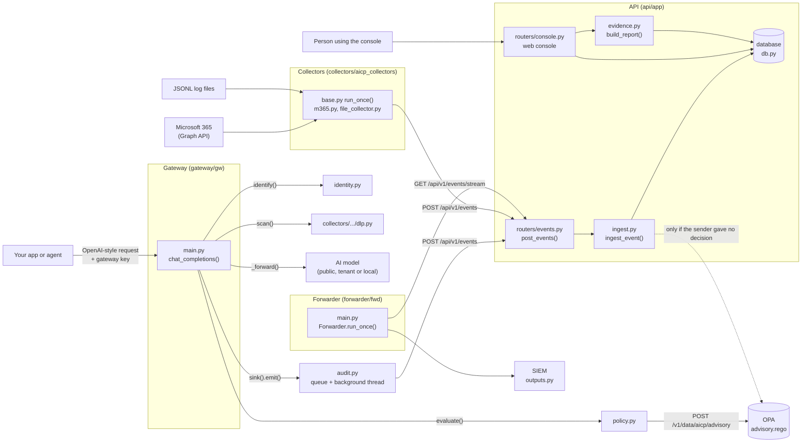
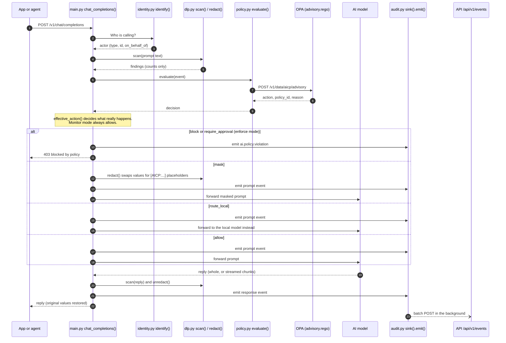
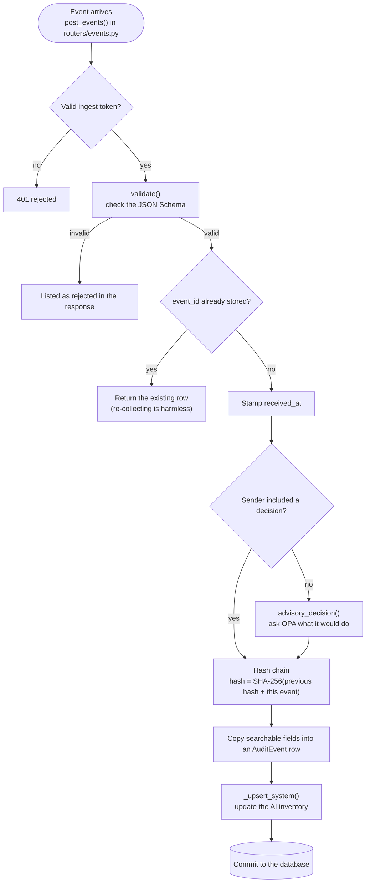
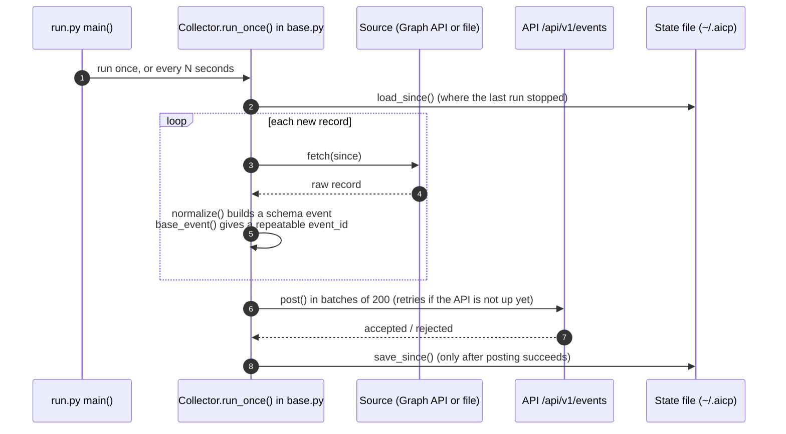
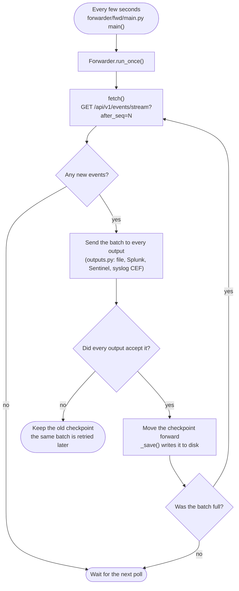
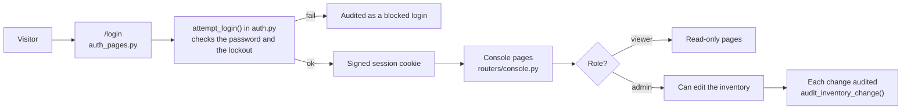

# How Gyrai works: code map

This page shows how a request moves through the code. Each box names the file or function you can open to follow along. GitHub draws the diagrams automatically.

Gyrai has four programs. They share one event format (`schemas/audit-event.schema.json`) and meet at the API.

| Program | Folder | Job |
|---|---|---|
| Gateway | `gateway/gw/` | Sits between an app and the AI model. Scans each request, applies policy, forwards it and audits it. |
| Collectors | `collectors/aicp_collectors/` | Read logs from tools Gyrai cannot sit in front of (Microsoft 365, log files) and turn them into events. |
| API and console | `api/app/` | Validates and stores events, keeps the AI inventory, builds evidence reports and serves the web console. |
| Forwarder | `forwarder/fwd/` | Copies stored events to a SIEM. |

Policy decisions come from OPA, which runs the rules in `policies/advisory.rego`.

## 1. The whole system

## 2. One chat request through the gateway

The path in `gateway/gw/main.py`, `chat_completions()`. Everything the gateway does happens here, in this order.

If the API is down, `audit.py` writes the events to a local fallback file instead of losing them.

## 3. How an event is stored

Every event from every source goes through `ingest_event()` in `api/app/ingest.py`.

`verify_chain()` in the same file re-computes the chain from the start. If anyone changed or removed a stored event, the check reports the first record that no longer matches.

## 4. How a collector works

Adding a new source means writing one class that implements `fetch()` and `normalize()`. See the top of `collectors/aicp_collectors/base.py`.

## 5. How events reach the SIEM

Because the checkpoint only moves after all outputs accept a batch, a SIEM outage causes a delay and never a gap. Delivery is "at least once", so a SIEM may see an event twice, and `event_id` is the key to remove duplicates.

## 6. Who can do what in the console

Every login, logout, password change and inventory edit becomes an audit event too, so the tool's own use is part of the record.
